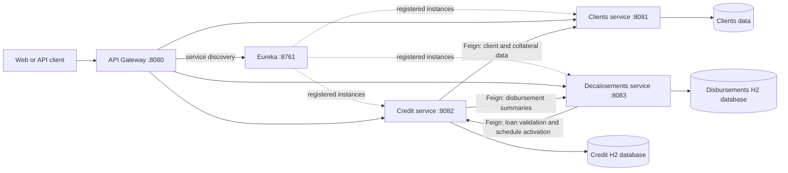
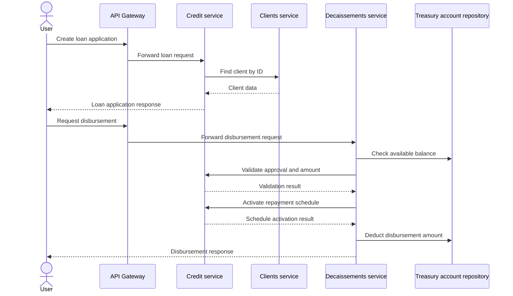

# CreditGo SPRING Microservices

CreditGo is a Spring Boot microservices project built from independently deployable services. Eureka provides service discovery, and the API Gateway is the intended entry point for external requests.

---

## Architecture



Each service owns its data and exposes HTTP endpoints. The service-to-service calls use Feign and Eureka discovery; the services do not share Java modules.

## Loan and disbursement flow



Credit enrichment also requests client, collateral, and disbursement data from the owning services.

## Module layout

```
.
├── clients/                  # Client and collateral service
├── service-credit/           # Loan-application service
├── service-decaissements/    # Decaissement handling service
├── api-gateway/              # Spring Cloud Gateway 
├── discovery/                # Service registry "eureka"
└── README.md
```

The gateway route prefixes currently configured in `api-gateway` do not match all service controller paths. For example, the credit controller uses `/api/loan-applications`, while the configured gateway route matches `/api/credit/**`; decaissements has the equivalent mismatch. Configure route rewrites or align the route prefixes before relying on those gateway routes.

---

