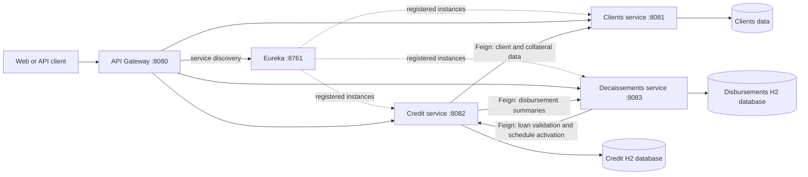
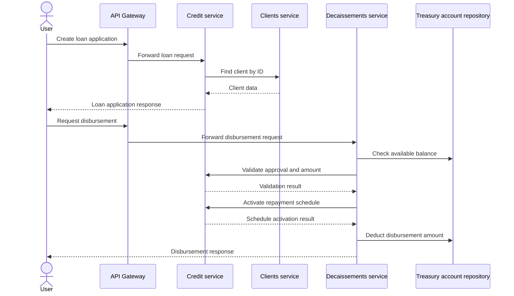

# CreditGo SPRING Microservices

CreditGo is a Spring Boot microservices project built from independently deployable services. Eureka provides service discovery, and the API Gateway is the intended entry point for external requests.

---

## Architecture



Each service owns its data and exposes HTTP endpoints. The service-to-service calls use Feign and Eureka discovery; the services do not share Java modules.

## Loan and disbursement flow



Credit enrichment also requests client, collateral, and disbursement data from the owning services.

## Module layout

```
.
├── clients/                  # Client and collateral service
├── config-repo/              # Git-backed shared and service configuration
├── config-server/            # Spring Cloud Config Server
├── service-credit/           # Loan-application service
├── service-decaissements/    # Decaissement handling service
├── api-gateway/              # Spring Cloud Gateway 
├── discovery/                # Service registry "eureka"
└── README.md
```

The root `pom.xml` aggregates all application modules, so Maven and IntelliJ can import them from the repository root. Open the root POM as a Maven project or reload Maven after pulling changes. Start each module from the root with `mvn -pl <module> spring-boot:run`, such as `mvn -pl config-server spring-boot:run`.

Start Config Server first, followed by Eureka and the Config Client applications. Clients, Credit, Decaissements, and the API Gateway load configuration from Config Server. Eureka and Config Server keep local configuration to avoid a startup dependency cycle.

The gateway route prefixes currently configured in `api-gateway` do not match all service controller paths. For example, the credit controller uses `/api/loan-applications`, while the configured gateway route matches `/api/credit/**`; decaissements has the equivalent mismatch. Configure route rewrites or align the route prefixes before relying on those gateway routes.

## Continuous Integration

The GitHub Actions workflow in `.github/workflows/ci.yml` 
runs on pushes to `main`, 
pull requests, and manual dispatch. 
It checks Config Server responses,
runs `mvn verify` across all reactor modules,
starts the services, and runs local smoke checks.

## Local checks

Run the Maven tests after starting Config Server:

```powershell
.\scripts\test-local.ps1
```

Start Config Server, Eureka, Clients, Credit, Decaissements, and API Gateway in separate terminals. Then run the smoke checks from the repository root:

```powershell
py -3 scripts/smoke-test.py
```

The smoke script checks that each configuration is served, 
Eureka responds, each service API responds, 
and the Gateway can reach Clients.

---

