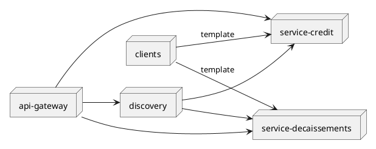
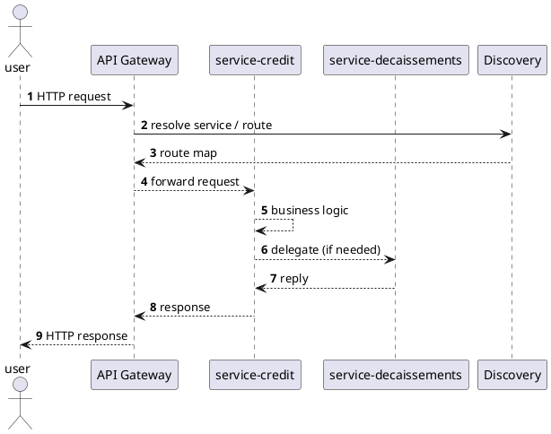

# CreditGo SPRING Microservices

CreditGo is a Spring Boot microservices project built from a set of independently
deployable modules. The workspace is organized around:

- **Template module** (`clients`) a Maven archetype-style copy used to bootstrap
  new modules (e.g., `credit`).
- **Service modules** (`service-credit`, `service-decaissements`, …)  domain services
  exposing REST endpoints and domain repositories.

---

## Module layout

```
.
├── clients/                  # archetype module
├── service-credit/           # Loan-application service
├── service-decaissements/    # Decaissement handling service
├── api-gateway/              # Spring Cloud Gateway 
├── discovery/                # Service registry "eureka"
└── README.md                 
```

---

## Module map



---

## Breaking request flow



---

## Build and run


### Prerequisites

- JDK 17+
- Maven 3.8+

### Compile every module

```bash
mvn -q -am compile
```

### Package every module

```bash
mvn -q -am package
```

### Run a single service

```bash
# e.g., the loan-application service
cd service-credit
mvn spring-boot:run
```

### Run the whole stack

```bash
# Start discovery, then the services, then the gateway
./mvnw spring-boot:run -pl discovery,service-credit,service-decaissements,api-gateway
```

